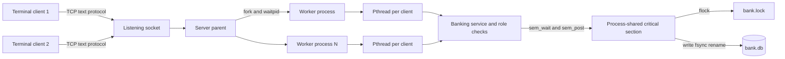
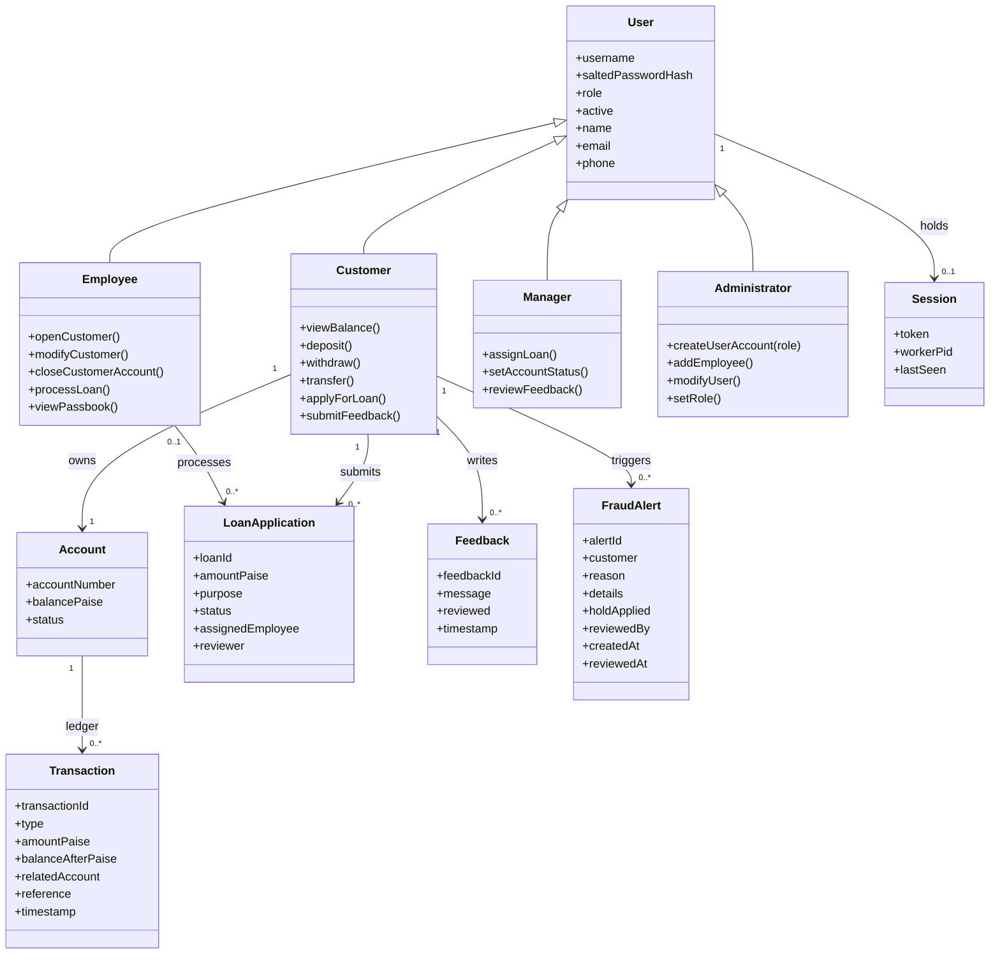
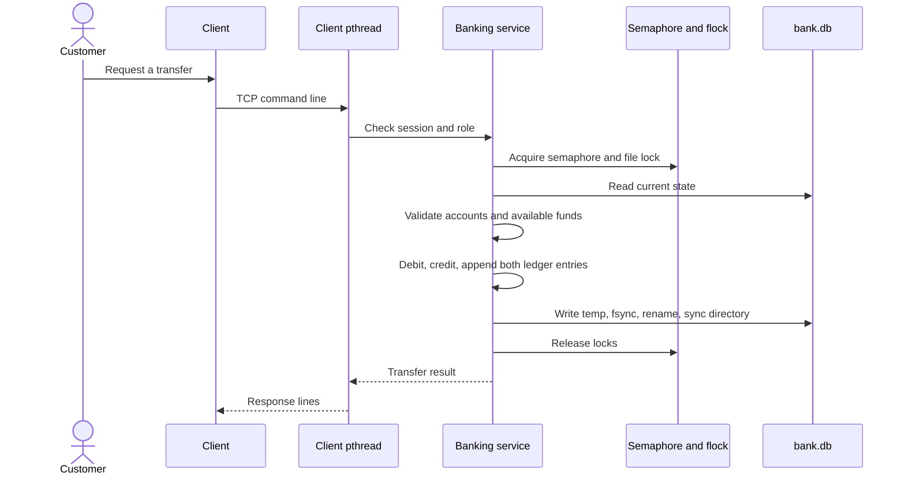

# Project Blueprint

## Process architecture

The parent accepts no clients directly. Worker processes inherit the listening socket and accept connections concurrently. Each connection has one client thread and one authenticated session. All state changes pass through the banking service and acquire the semaphore and file lock.

## Domain class diagram

The role types in this conceptual diagram are stored as role values in C user records; the implementation uses shared C structures rather than separate object subclasses.

## File database schema

`data/bank.db` is a line-oriented database. User-controlled text cannot contain the `|` field separator or control characters. Monetary values are integer paise.

| Record | Fields | Purpose |
| --- | --- | --- |
| `META` | next account, transaction, loan, feedback, and fraud alert IDs | ID generation. The loader accepts the older four-ID format too. |
| `USER` | username, salt, password hash, role, active flag, contact details | Credentials and permissions. |
| `ACCOUNT` | username, account number, balance, status (`ACTIVE`, `INACTIVE`, `CLOSED`, or `FRAUD_HOLD`) | Customer account state. A fraud hold is released through administrator alert review. |
| `TX` | ID, owner, type, amount, balance after, related account, reference, time, memo | Passbook and audit trail. |
| `LOAN` | ID, applicant, amount, purpose, status, assignee, reviewer, timestamps | Loan processing workflow. |
| `FEEDBACK` | ID, customer, message, reviewed flag, timestamp | Customer feedback. |
| `FRAUD` | ID, customer, reason, details, hold flag, reviewed flag, creation time, reviewer, review time | Persistent fraud alert history and account hold audit. |
| `SESSION` | username, random token, worker PID, last activity | One active login per user. |

## Transaction sequence

Fraud checks run inside the same locked operation before a suspicious transfer is posted. A transfer of Rs 100,000 or more, or the third outgoing transfer within five minutes, is blocked and creates a hold alert. Three insufficient-funds transfers or withdrawals within ten minutes create a hold. The attempt and alert are saved through the regular snapshot commit path. An administrator can list alerts and resolve them; the account returns to `ACTIVE` only after all its open hold-causing alerts have been reviewed.

## Requirement mapping

| Requirement from the project brief | C implementation |
| --- | --- |
| Socket programming and multiple clients | IPv4 TCP sockets in `src/server.c`; `src/client.c` connects using `getaddrinfo()`. |
| Concurrent clients | Parent uses `fork()` for worker processes; each worker starts a pthread for each accepted client. |
| Process management | Parent reaps workers with `waitpid()` and starts a replacement if one exits. |
| File management and locking | POSIX `open`, `read`, `write`, `fsync`, `rename`, `flock`, and directory sync. |
| Semaphores and synchronization | `sem_open`, `sem_wait`, and `sem_post` serialize database operations across worker processes and threads. |
| One session per user | Session records and random tokens are stored in the database and checked on each request. |
| ACID-oriented updates | One critical section validates and changes the state; a complete replacement file is synced and atomically renamed into place. |
| Roles and modules | Customer, employee, manager, and administrator operations are enforced by server-side role checks. |
| Rule-based fraud review | Transfer amount, recent transfer velocity, and repeated insufficient-funds attempts create saved alerts and administrator-reviewed account holds. |
