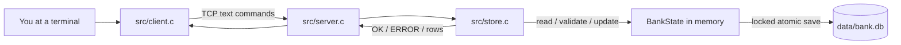

# Banking Management System Learning Guide

This guide walks through the project from startup to a saved banking operation. Read it with the source open, following the named functions as they are introduced. The project is a local educational simulation: it uses a TCP client and server, but it does not connect to a real bank.

## 1. Start with the system's shape

The terminal client collects input and displays results. The server owns authentication, permissions, banking rules, and the database. The storage code loads a complete database snapshot, applies one command, and saves the snapshot when it changes.



The main files are:

| File | What to look for |
|---|---|
| `src/bank.h` | Shared record types, size limits, and functions used across modules. |
| `src/client.c` | Terminal prompts, role menus, TCP connection, and command formatting. |
| `src/server.c` | Listening socket, worker processes, client threads, and connection cleanup. |
| `src/store.c` | Login, role checks, banking operations, synchronization, and file persistence. |
| `Makefile` | Compiler flags, dependencies, and the two executable targets. |
| `DESIGN.md` | Architecture and class diagrams, file schema, and requirement mapping. |

## 2. Build and run the programs

Follow the WSL setup in `README.md`. The project uses a C compiler, `make`, POSIX APIs, and OpenSSL development files. Build from the project directory:

```bash
make
```

This creates two programs under `build/`:

- `bank_server` listens for clients and updates the database.
- `bank_client` connects to the server and presents the menus.

Open one WSL terminal for the server:

```bash
./build/bank_server 5050 4 ./data
```

The arguments are port `5050`, four worker processes, and the data directory `./data`. Open a second WSL terminal in the same project directory for a client:

```bash
./build/bank_client 127.0.0.1 5050
```

The server seeds demo accounts when `data/bank.db` does not exist. Demo sign-ins are `alice / alice123`, `employee / employee123`, `manager / manager123`, and `admin / admin123`. Stop the server with Ctrl+C. The database remains in `data/bank.db` between runs.

## 3. Learn the shared data types first

Open `src/bank.h`. The types in this header are used by both the server and storage code.

- `BankUser` represents a login identity and its role. It stores a random salt and a password hash instead of a plaintext password.
- `BankAccount` stores the customer account number, status, and balance.
- `BankTransaction` is one passbook row. A transfer has one row for the sender and one for the recipient, connected by a shared reference.
- `BankLoan` stores an application and its status as it moves through review.
- `BankFeedback` stores a customer message and whether a manager has reviewed it.
- `BankSessionRecord` is the shared, saved form of a login session.
- `BankState` is the complete in-memory database. Each `*_count` says how many entries at the start of its fixed-size array are in use.
- `BankSession` is the thread's local copy of a login. Its token must match the saved session record.

Balances and transaction amounts use integer paise. One rupee is 100 paise. Integer arithmetic avoids errors caused by representing money with floating-point numbers.

## 4. Follow one login from the prompt to the database

Use Alice's demo account to trace this path:

1. `main()` in `src/client.c` connects to the host and port using `connect_server()`.
2. The client asks for a username and hidden password, then `send_request()` formats a line such as `LOGIN|alice|alice123` and adds a newline.
3. In `src/server.c`, a worker's `accept()` returns a new socket for this client. The worker starts `client_thread()` to handle it.
4. `client_thread()` reads one request line at a time and calls `bank_execute()` in `src/store.c`.
5. `bank_execute()` splits the line at each `|`. It sends `LOGIN` to `login_operation()` through `run_locked()`.
6. `run_locked()` acquires the semaphore and file lock, then loads the current database. This makes login decisions use the latest shared state.
7. `login_operation()` looks up Alice, checks the password hash, rejects duplicate active sessions, creates a random token, and saves a session record.
8. The server returns an `OK` line followed by `END`. The client captures the role from the `OK` line and opens the customer menu.

The client menu decides which prompts to show. `dispatch_command()` in the server still checks the user's role for each command, so a client cannot gain permission by sending a command directly.

## 5. Understand the request and response format

Commands are plain text. A pipe separates fields, and a newline ends the request. For example:

```text
TRANSFER|bob|25.50
```

This asks the server to transfer 25 rupees and 50 paise to username `bob`. A typical response has a status line, optional result rows, and an `END` line:

```text
OK|Transfer completed.
DATA|TR0000001
END
```

The `OK` or `ERROR` line communicates the result. `DATA` carries a single result, and `ROW` is used for list results such as transaction history. `send_request()` keeps reading until `END`, so rows from one command cannot be mistaken for the next command's response.

The pipe and newline characters have meaning in this format. The client rejects them in ordinary input, and the server validates fields again before saving them.

## 6. Trace a transfer end to end

The customer menu in `customer_menu()` sends `TRANSFER|recipient|amount`. Follow the command into the `TRANSFER` branch in `dispatch_command()`:

1. Check that the command has the expected number of fields and that the caller is a customer.
2. Parse the amount into integer paise. Reject invalid amounts, transfers to the same user, inactive accounts, and insufficient funds.
3. Check that there is room for two more transaction records.
4. Debit the sender and credit the recipient in the in-memory `BankState`.
5. Add a `TRANSFER_OUT` and a `TRANSFER_IN` passbook row. Both rows share one reference.
6. Return to `run_locked()`, which writes the changed state once through `save_database()`.
7. Send the response to the client, which displays the result and waits for the next menu choice.

The two accounts and both passbook rows are part of one snapshot. If the process is interrupted before the replacement file is renamed, the previous database file remains in place.

## 7. Follow a loan through all three roles

Use separate client terminals for the customer, manager, and employee:

1. **Customer:** choose “Apply for a loan.” `customer_menu()` sends `LOAN_APPLY|amount|purpose`. The server validates the amount and creates a loan with status `PENDING`.
2. **Manager:** choose “View unassigned loan applications,” then “Assign a loan to an employee.” The manager's command changes the loan to `ASSIGNED` and records the employee username.
3. **Employee:** choose “View assigned loan applications,” then “Approve or reject a loan.” The server only permits the employee assigned to that application to decide it.
4. **Approval:** the customer's active account is credited, a `LOAN_DISBURSEMENT` transaction is added, and the loan becomes `APPROVED` in the same saved snapshot.
5. **Rejection:** the loan becomes `REJECTED`; no money is added to the account.

This is a useful example of why roles are checked in `dispatch_command()` rather than being trusted from the menu.

## 8. See how multiple clients share the database safely

The server has two levels of concurrency:

- The parent uses `fork()` to create worker processes.
- Each worker uses `accept()` and creates a pthread for each connected client.

Each client thread can run at the same time as other threads. A single database update must still happen in order. `lock_database()` first waits on the POSIX semaphore shared by this server's workers. It then takes an exclusive `flock()` on `bank.lock`. The semaphore coordinates threads and forked workers; the sidecar file lock also coordinates another server process using the same data directory.

The lock stays held while the code loads, validates, changes, and saves the state. A second operation therefore reads the first operation's saved result instead of editing an older copy.

## 9. Connect the code to ACID

These are the design ideas used by the file-backed transaction path:

| Property | Where to look | What the code does |
|---|---|---|
| Atomicity | `run_locked()` and `save_database()` in `src/store.c` | Writes a complete replacement snapshot and renames it over the old file. A reader sees a complete old or new file. |
| Consistency | Command branches in `dispatch_command()` | Checks roles, active account status, valid amounts, sufficient funds, record limits, and loan workflow state before saving. |
| Isolation | `lock_database()` and `unlock_database()` | Serializes the database read/modify/save section with a semaphore and file lock. |
| Durability | `save_database()` | Writes the temporary file, calls `fsync()`, renames it, and attempts to sync the containing directory. |

This describes the educational implementation's file-backed design. It is not a production banking platform or a substitute for testing storage behavior on the deployment filesystem.

## 10. Understand the database file

`data/bank.db` is a line-oriented text file. Each line starts with a record type and contains pipe-separated fields. `load_database_record()` translates each line into one structure; `save_database()` writes those structures back in the same format.

| Record tag | Represents |
|---|---|
| `META` | Next account, transaction, loan, and feedback IDs. |
| `USER` | Login name, password salt/hash, role, active flag, and contact details. |
| `ACCOUNT` | Customer account number, balance in paise, and status. |
| `TX` | Passbook transaction and balance after that transaction. |
| `LOAN` | Application, assignment, decision, and timestamps. |
| `FEEDBACK` | Customer message and manager-reviewed flag. |
| `SESSION` | Active username, random token, worker PID, and last activity. |

Do not edit the database while the server is running. The next update rewrites the complete file, and manual changes could make a record invalid.

## 11. Read the code in a productive order

1. Read the type definitions in `src/bank.h` so names such as `BankState` and `BankSession` are familiar.
2. Read the top-level comment and `main()` in `src/client.c`. Then read `send_request()` and one role menu.
3. Read `main()` in `src/server.c` to see how the semaphore, store, listening socket, and worker pool are started.
4. Follow `client_thread()` into `bank_execute()` in `src/store.c`.
5. Read `run_locked()` before reading operations. It explains how every operation gets the current state and how changes reach disk.
6. Read `authenticated_operation()` and `dispatch_command()` to see session validation and role-specific rules.
7. Read `load_database()` and `save_database()` to see how the text file becomes structures and returns to disk.
8. Trace `TRANSFER` and then the loan workflow. These show the important multi-record updates.

When a function name is unfamiliar, search for its definition and its call sites. The client usually formats a command, the store validates it, and the server thread sends the resulting response.

## 12. Practice and check your understanding

Try these small exercises with the demo accounts and separate terminals:

1. Sign in as Alice and view her balance and transaction history. Find the matching `BALANCE` and `HISTORY` branches in `dispatch_command()`.
2. Make a small deposit. Compare the new balance with the added `TX` row in `data/bank.db` after stopping the server.
3. Start two clients as Alice. Confirm the second login is rejected while the first session is active. Find the check in `login_operation()`.
4. Apply, assign, and approve a loan. Follow the `PENDING` → `ASSIGNED` → `APPROVED` status changes and the resulting `LOAN_DISBURSEMENT` row.
5. Run two funded customers in separate clients and transfer to the same recipient. Then inspect the recipient's balance and history.

Questions to answer as you read:

- Which function decides whether a request is allowed for a role?
- Which function guarantees that a write reaches the database file as a complete snapshot?
- Why does a transfer add two ledger rows?
- What is the difference between the thread-local `BankSession` and saved `BankSessionRecord`?
- Which locks protect the shared data while a command runs?

If you can answer those questions and trace one transfer from the menu to `bank.db`, you have followed the central path through the project.
